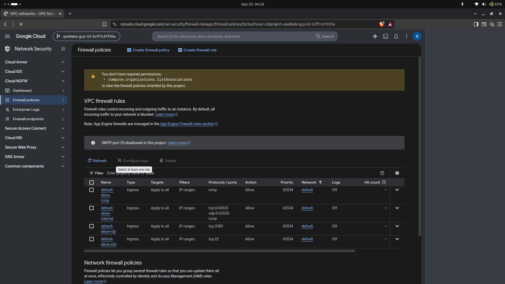

# GCP VPC Firewall Rules & Network Security

> Practical documentation and hardening guide for Google Cloud VPC default firewall rules, Cloud NGFW policies, and perimeter risk mitigation.

- **Repository:** `your-username/gcp-firewall-rules`
- **Author:** Muhammed Abdulazeez
- **Platform:** Google Cloud Platform (Network Security / Cloud NGFW)

## Overview

When a new Google Cloud project is created with the `default` VPC network, GCP automatically provisions four permissive ingress firewall rules at priority `65534` with logging disabled (`Off`) and targets set to **Apply to all** instances. While convenient for quick prototyping, leaving `default-allow-ssh` (`tcp:22`) and `default-allow-rdp` (`tcp:3389`) open to the public internet exposes compute instances to automated scanning and brute-force attacks.



## Repository Structure

```text
gcp-firewall-rules/
├── README.md
├── CHECKLIST.md
├── CONTRIBUTING.md
├── .gitignore
├── assets/
│   └── 01-default-firewall-rules.png
└── docs/
    ├── 01-default-firewall-rules.md
    └── 02-firewall-hardening-and-policies.md
```

## Default VPC Firewall Rules Summary

| Rule Name | Direction | Targets | Protocols / Ports | Action | Priority | Logs | Guide |
| :--- | :--- | :--- | :--- | :--- | :--- | :--- | :--- |
| `default-allow-icmp` | Ingress | Apply to all | `icmp` | Allow | `65534` | Off | [Inspect Rule](docs/01-default-firewall-rules.md) |
| `default-allow-internal` | Ingress | Apply to all | `tcp:0-65535`, `udp:0-65535`, `icmp` | Allow | `65534` | Off | [Inspect Rule](docs/01-default-firewall-rules.md) |
| `default-allow-rdp` | Ingress | Apply to all | `tcp:3389` | Allow | `65534` | Off | [Inspect Rule](docs/01-default-firewall-rules.md) |
| `default-allow-ssh` | Ingress | Apply to all | `tcp:22` | Allow | `65534` | Off | [Inspect Rule](docs/01-default-firewall-rules.md) |

## Key Observations from Cloud Console

1. **Implied Baseline**: By default, all incoming traffic to a VPC network is blocked (`65535` implied deny ingress) unless explicitly permitted by a higher-priority rule such as `65534`.
2. **SMTP Restriction**: Google Cloud blocks outbound `SMTP port 25` by default in standard projects to prevent abuse.
3. **Organization Policy Visibility**: Viewing inherited hierarchical firewall policies requires `compute.organizations.listAssociations` IAM permission.
4. **Logging Disabled**: All four default rules ship with Firewall Rules Logging set to **Off**, limiting visibility into accepted connection attempts.

## Quick Start

```bash
git clone https://github.com/your-username/gcp-firewall-rules.git
cd gcp-firewall-rules
```

Review the verification steps in [CHECKLIST.md](CHECKLIST.md) before promoting a VPC network to production.

## License

Released under the MIT License.
