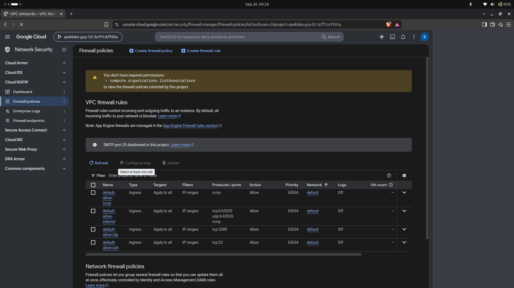

# 01. Default VPC Firewall Rules Analysis

In Google Cloud **Network Security > Cloud NGFW > Firewall policies**, a newly initialized `default` VPC network contains four pre-configured ingress rules evaluated just above the implied deny-all ingress rule (`65535`).



---

## Observed Rule Inventory

| Name | Type | Targets | Filters | Protocols / Ports | Action | Priority | Network | Logs |
| :--- | :--- | :--- | :--- | :--- | :--- | :--- | :--- | :--- |
| `default-allow-icmp` | Ingress | Apply to all | IP ranges (`0.0.0.0/0`) | `icmp` | Allow | `65534` | `default` | Off |
| `default-allow-internal` | Ingress | Apply to all | IP ranges (`10.128.0.0/9`) | `tcp:0-65535`, `udp:0-65535`, `icmp` | Allow | `65534` | `default` | Off |
| `default-allow-rdp` | Ingress | Apply to all | IP ranges (`0.0.0.0/0`) | `tcp:3389` | Allow | `65534` | `default` | Off |
| `default-allow-ssh` | Ingress | Apply to all | IP ranges (`0.0.0.0/0`) | `tcp:22` | Allow | `65534` | `default` | Off |

---

## Security Implications

1. **Broad Internet Exposure (`0.0.0.0/0`)**
   Both `default-allow-ssh` (`tcp:22`) and `default-allow-rdp` (`tcp:3389`) allow inbound administrative connections from any public IP address to **all** VM instances in the `default` network that have external IPs.
2. **Flat Internal Lateral Movement (`default-allow-internal`)**
   All ports (`tcp:0-65535`, `udp:0-65535`, `icmp`) are permitted across every subnet inside the VPC, allowing compromised workloads to probe neighboring services without restriction.
3. **Zero Audit Telemetry (`Logs: Off`)**
   Because logging is disabled on all four rules, security teams cannot inspect hit counts or source IPs in Cloud Logging unless logging is explicitly enabled.
4. **Organization Inheritance Blind Spots**
   Without `compute.organizations.listAssociations`, project-level operators cannot verify whether higher-level organization or folder firewall policies are already enforcing guardrails above the VPC.

## Auditing via `gcloud` CLI

Inspect active firewall rules and logging status from Cloud Shell or a workstation:

```bash
gcloud compute firewall-rules list \
  --filter="network:default" \
  --format="table(name,direction,priority,sourceRanges.list():label=SRC_RANGES,allowed[].map().firewall_rule().list():label=ALLOW,logConfig.enable:label=LOGS)"
```
